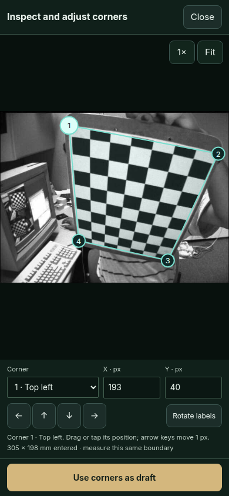

# Source Studio — experimental runtime b71cfdc6530e

This is an interim, versioned repository download. A formal GitHub Release has not been published; that publishing gap remains open.

[Download the prepared runtime ZIP](skill-translator-b71cfdc6530e-runtime.zip?raw=true) · [Source commit](https://github.com/Jacob-Met/skill-translator/commit/b71cfdc6530ebd776ccb1e6ab49b71dba86f3fe2) · [Photo outlines PR](https://github.com/Jacob-Met/skill-translator/pull/519) · [Image inspection PR](https://github.com/Jacob-Met/skill-translator/pull/520)

## Start the app

1. Download and extract the entire ZIP.
2. Install Node.js 20 or newer. Node is not included.
3. In the extracted directory, run `node launch.mjs`. Windows also provides `start.cmd`; macOS/Linux provides `sh start.sh`.
4. Open the printed loopback URL and choose **Annotate your own source photo**, or open `http://127.0.0.1:8787/capture`.

No npm install, service key or image upload is needed for this photo workflow. Optional native audio/vision helpers have separate dependencies described in START_HERE.txt. This archive was exercised on Linux with Node 22 and sandboxed Chrome 156; the presence of Windows/macOS launch scripts does not establish testing on those platforms.

ZIP: 2,075,491 bytes. SHA-256:
`d567459ea112f04bfa1e163b9933a9a328ca49f9d3f65a9684fef46d5bfab9fe`

Exact source commit: `b71cfdc6530ebd776ccb1e6ab49b71dba86f3fe2`.
Exact source tree: `8d5084f4a2304189eb44bb49d34f2903b39120c6`.
The maintained packager includes 789 files, including 569 browser assets, and a per-file manifest.

## Use the photo and manual corner inspector

Choose your local PNG/JPEG, then **Find outlines in this photo**. A proposed outline opens the original photograph with editable numbered corners. Select a corner, drag or tap its location, type pixel coordinates, or use one-pixel arrow controls. Magnify the active corner and use Fit to return to the full image. Rotate labels if necessary, then choose **Use corners as draft**. Review independently measured dimensions and explicitly **Apply calibration**.

**Inspect and adjust corners** also opens an existing or empty manual draft without scanning. Close or Escape discards inspector edits. Accepted source marks remain available for editable-package export/reopen and practice.

Measure the same boundary the accepted corners enclose. The checkerboard examples enclose the printed face, not its dark backing. The photo cannot supply physical scale.

## Independent judgment and remaining gaps

Independent reviewer astra-kestrel-71b9 rechecked frozen source 49c06b94, whose source tree is identical to this runtime, using original OpenCV left07 at 390×844. They viewed their actual phone pixels and confirmed the photograph, four numbered corners, coordinate/nudge/rotate controls and draft adoption together. They exercised 2 px correction, zoom/Fit, adoption, reopening/cancel, explicit calibration, .stsource export/reopen and practice with the retained mark; no page errors or overflow were observed. They accepted this as a real product improvement over the earlier screen, where controls could occupy the viewport without the photograph.

Top remaining product gaps are whole-object versus interior-region choice in Sudoku/clutter, and validation on ordinary colored paper/boards with known physical geometry. This selective region detector is not automatic physical calibration.

Author checks include 39 Node subtests on the proposal integration, 8 native calibration groups, the exact vendor pin, the existing authored browser course, and a further real-photo inspector course with zoomed drag, keyboard/button correction, cancellation and manual placement without a scan. The inspector course also passed against the extracted runtime itself. The recorded 305×198 mm dimensions are test values, not measured truth for the source photograph. No human timing advantage or physical accuracy has been established.

The detector proposed the printed checkerboard face in four selected OpenCV photographs; three views were held out after tuning. An ordinary fixed OpenCV contour baseline found two of those four. The baseline finds the full Sudoku grid where this detector still offers interior regions; both omit box_in_scene. These selected images share a scene and are not a representative benchmark. Full method, provenance and limitations are in the packaged docs/PHOTO_CORNERS.md and the source repository.

## Actual app evidence

[11.2-second browser clip](photo-inspection.mp4?raw=true) — real interaction on the packaged runtime, slowed to two-thirds speed for readability. The photo and measurements are the OpenCV example/test values described above.

[Author course receipt](course.json) · [Phone corner detail](phone-corner-detail.png) · [Desktop inspector](desktop-inspection.png)

## Image attribution

The photograph in screenshots and recording is OpenCV `samples/data/left02.jpg`, original Git blob `457820e90aa2ff189ffb62fd7fdcc81d66c7885e`, from the [OpenCV sample data](https://github.com/opencv/opencv/blob/4.x/samples/data/left02.jpg). It is displayed with interface annotations in this evidence. OpenCV's Apache 2.0 license is reproduced in [OPENCV_LICENSE.txt](OPENCV_LICENSE.txt). Runtime vendor notices are retained inside the archive. No private user photograph is included.
